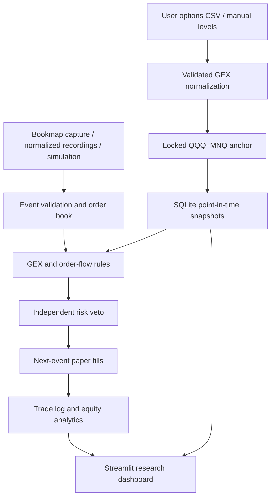

# GEX + Bookmap Trading System

An event-driven **MNQ paper-trading research system** combining user-supplied QQQ options positioning levels with measured order flow. Built as a Computer Engineering portfolio project by Nathrawi Negussie.

**Status:** runnable Python MVP with seven Streamlit pages, tested ingestion, mapping, strategy, independent risk controls, and replay. The Java Bookmap capture add-on remains experimental. The owner reports that Bookmap recognizes the locally built add-on, but MNQ activation is restricted pending Bookmap/provider review. That local Java build and a working live connection have not been independently verified. No brokerage integration or live orders exist. No profitability claim is made.

## Quick start and VS Code

Python 3.12 or newer is required. Open this folder in VS Code, then use its terminal:

```bash
python -m venv .venv
# macOS/Linux
source .venv/bin/activate
# Windows PowerShell: .venv\Scripts\Activate.ps1
python -m pip install -e ".[dev]"
python -m pytest -q
python -m streamlit run app.py --server.address 127.0.0.1
```

Select `.venv` with **Python: Select Interpreter**. Recommended extensions, dashboard debugging and test tasks are included in `.vscode`. Run the dashboard with F5 or the command above. No credentials are needed for local research. Keep the app bound to localhost.

For a reproducible example, open **Backtesting → Run synthetic verification example**, then review **Overview**, **Bookmap Order Flow**, and **Strategy Monitor**. Alternatively:

```bash
python -m gexbook.cli inspect-capture --events data/samples/SYNTHETIC-events.jsonl
python -m gexbook.cli demo
python -m gexbook.cli replay --events data/samples/SYNTHETIC-events.jsonl --snapshots data/samples/SYNTHETIC-snapshots.json
```

The supplied fixtures are invented software-test data, visibly labeled **SIMULATION — NOT HISTORICAL PERFORMANCE**. They are not options observations or evidence of a trading edge. Reports are written beneath `runtime/latest/`. Dashboard research bundles include configuration, snapshots, input hashes, data coverage, trades, equity and decisions. Raw options and feed files are excluded; exported levels and paper settings can still be private.

## Architecture



The same `Engine.step()` pipeline powers recorded replay and local file-tail paper processing. Timestamps, sequence continuity, symbol consistency, freshness, initial resets and available depth, and snapshot availability are checked before entries.

## Engineering problems solved

- **Data normalization:** heterogeneous Barchart-style long/wide CSV headers, preambles, numeric suffixes, and expiration filtering; missing fields produce explicit limitations instead of manufactured calculations.
- **Cross-instrument coordinates:** immutable session reference anchors, approximate conversion, tick rounding, source coordinates, override reasons and append-only snapshots.
- **Event-driven processing:** normalized depth/trade events, bounded rolling metrics, separate provider adapters and consistent replay/live-file decision logic.
- **Safety boundaries:** risk sizing independent of signals, cost-aware reward/risk, stale-data vetoes, daily loss budgets and emergency lockout.
- **Reproducible research:** immutable availability timestamps, no input sorting that conceals corruption, chronological out-of-sample evaluation, recorded explanations and targeted automated tests.

## GEX assumptions and daily workflow

1. Upload your CSV in **GEX Levels**; select a calculation assumption and validate it.
2. Review warnings and supported levels. Enter or edit actual manual levels as needed.
3. Lock a session factor or supply QQQ and MNQ references with timestamps no more than two seconds apart and no more than 60 seconds old.
4. Map levels, save a session snapshot, and download point-in-time JSON for replay/capture.
5. Restart the file-tail process with the intended snapshot file when updating its session inputs. The dashboard does not hot-reload an existing capture engine's settings or snapshots.

Unsigned exposure is `gamma × open interest × 100 × QQQ spot² × 0.01`, in dollars per 1% QQQ move. Gamma alone does not establish dealer sign. The optional **calls-positive / puts-negative** model is an explicit inventory assumption, not observed dealer positioning. Provided signed GEX requires declared units; provider methodology is not independently verified.

Call/put walls use gamma × OI concentrations when all relevant contract gamma values are available, otherwise explicitly labeled OI-only proxies. Neither establishes dealer positioning. Unsigned gamma concentrations are ranked relative to the largest concentration; support/resistance roles reflect location relative to the reference spot, not a guarantee of defense. Signed extrema and a positive-concentration pin candidate are supported when inputs justify them. A pin zone or gamma flip may be manually supplied. **The engine never infers gamma flip by interpolating signs across strikes**; a defensible spot-dependent repricing surface is not implemented. Missing gamma/OI prevents GEX calculation. IV/volume may be imported but do not substitute for missing gamma.

The locked factor maps QQQ levels approximately to MNQ. QQQ and Nasdaq futures differ in carry, dividends, composition and trading hours; their relationship is neither exact nor constant. Coordinates remain fixed during a session. Existing session anchors are reused unchanged; an explicit new session ID is required to re-anchor. Snapshot JSON records factor, lock/reference timestamps, QQQ and MNQ coordinates, provenance and override explanations. Importance scores are concentration rankings or user judgments, never success probabilities.

## Order flow and Bookmap

See [Bookmap integration](docs/BOOKMAP.md) for verified interfaces and setup limitations. Normalized JSONL/CSV adapters and the incremental file-tail reader are implemented and tested. Bookmap-specific exports must be translated to the documented schema; arbitrary proprietary files are not automatically understood.

| Metric | Implementation / limitation |
|---|---|
| Resting depth | Absolute bid/ask sizes per price level |
| Imbalance | Top-five `(bid − ask)/(bid + ask)` |
| Delta / CVD | Aggressor buy minus sell volume; CVD resets on Chicago calendar date |
| Additions / removals | Net depth changes; removals do not prove cancellations |
| Pulling / stacking | Net removal/addition quantities, not participant intent |
| Absorption | Opposing volume near a level in a narrow price range; approximation |
| Sweep candidate | Multiple traded price levels across a range; approximation |
| Icebergs | Unsupported; no invented detection |

NQ data can support analysis with `market_symbol=NQ`, but **cannot authorize MNQ fills**. A direct NQ-to-MNQ executable quote conversion is not implemented.

## Strategy and risk

Only GEX levels and order-flow inputs are used. Rejections require a matching support/resistance role, a recent approach, recovery/rejection beyond the level, meaningful resting liquidity, absorption approximation, strengthening directional delta, order-book imbalance and reliable data. Breakouts require previously observed opposing defense to diminish, directional flow and timed acceptance beyond the level with continuously qualifying directional flow. Defense observations expire after the rolling window. Defaults and formulas are in [strategy and risk](docs/STRATEGY.md).

The diagnostic score combines importance, distance, liquidity, absorption, delta, imbalance, confirmation and reliability. Required gates must pass irrespective of score. Each proposed/rejected candidate records its checks and explanation. Positive GEX does not automatically imply support; visible size is not presumed permanent or genuine.

Independent risk rules enforce balance, per-trade risk, remaining daily realized-loss budget, committed open stop risk, contracts, positions, consecutive losses, session restrictions and net reward/risk. Defaults: $10,000 paper balance, $100/trade, $300/day, three contracts, one position, three consecutive losses, 08:30–15:00 Chicago weekdays. This is a daytime weekday window, **not an exchange holiday calendar**. Personal settings saved from the dashboard live under ignored `runtime/paper-config.json`; tracked defaults remain unchanged. CLI and dashboard prefer this local file unless an explicit CLI configuration path is supplied.

MNQ is $2/point, 0.25-point ticks, $0.50/tick. Defaults use $0.65 commission/fees per side per contract and one adverse slippage tick; replace with your actual cost assumptions. Entry fills occur on a subsequent trade event at BBO plus slippage. Stops can gap; targets fill at their limit without price improvement. Optional entry-price breakeven excludes fees. Emergency flatten locks entries and waits for fresh executable quotes; it cannot fabricate a disconnected fill. Loss caps are planning limits, not guarantees against gaps.

## Backtesting and data

See [data contract](docs/DATA.md) and [backtesting](docs/BACKTESTING.md). Point-in-time snapshots must have been available before a decision. Recorded streams need resets, depth reconstruction and known aggressor sides. Inadequate data makes confirmations untestable, and no entry is justified by invented evidence.

Analytics include total trades, win rate, profit factor, average win/loss, net profit, marked equity drawdown, expectancy, duration, level/confirmation grouping and long/short grouping. Profit factor is null if no losing trades. Fixed-parameter chronological out-of-sample evaluation is available; optimization and rolling walk-forward search are future work.

For a five-minute recruiter walkthrough, see [portfolio demonstration](docs/PORTFOLIO.md).

## Development, security and roadmap

```bash
python -m ruff check .
python -m ruff format --check .
python -m pytest -q
```

GitHub Actions runs Python checks. Java compilation is a separate user-environment gate. Local runtime data, databases, credentials, private data, jars and build outputs are ignored. Put private CSVs under `data/private/`; do not move them into tracked samples. Audit logs may contain trading information and remain local. No secret or account identifier is required. Review staged files before publishing; you remain responsible for data-provider redistribution rights.

**Verified MVP:** normalization, locked mapping, snapshots, order flow, reversal/breakout rules, risk, paper fills, replay/OOS, analytics and seven dashboard pages. **Unverified external dependencies:** actual Bookmap entitlement/provider, initial book callbacks, the owner’s local Java build/deployment and real historical strategy performance.

Roadmap: validate SDK capture against the installed Bookmap version; provider-specific unit/reconnect certification; real event-level historical evaluation; holiday calendar; robust rolling walk-forward experiments; measured performance and storage scaling; full repricing-based gamma flip when sufficient user data exists. Live execution would require a separate explicitly authorized design and validation project.

Research software only. Futures are leveraged; this system is not investment advice, a production trading service or a promise of profitability. MIT license.
